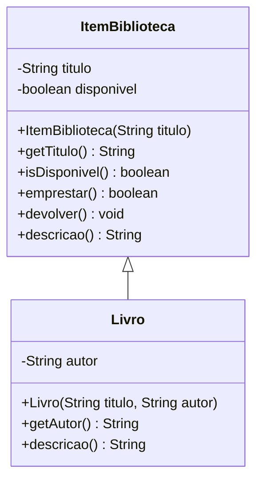

# Prática: da UML ao Java (biblioteca)

POO I • 3º INF • 27/10/2026 • aulas 3 e 4

Molde para começar. A ficha impressa traz o diagrama e as regras. Aqui estão os três arquivos no pacote padrão.

## O que fazer

1. Crie um projeto Java no NetBeans (JDK 21) com o pacote padrão.
2. Copie para esse projeto os três arquivos desta pasta: `Aplicacao.java`, `ItemBiblioteca.java` e `Livro.java`.
3. Complete os `TODO` em `ItemBiblioteca` e `Livro`. Não altere o `main` de `Aplicacao`.
4. Execute `Aplicacao` e confira se a saída coincide com os comentários do `main`.

`Livro` herda de `ItemBiblioteca`. O construtor do livro já chama `super(titulo)`.



## Regras que o código precisa cumprir

- Título e autor nulos ou em branco geram `IllegalArgumentException`.
- O item nasce disponível. `emprestar` retorna `false` se já estiver emprestado; senão, marca como indisponível e retorna `true`. `devolver` torna o item disponível de novo.
- `descricao` da superclasse devolve `Item: ` e o título. `Livro` sobrescreve e devolve `Livro: `, o título, ` | Autor: ` e o autor. Use `@Override`.

## Como rodar sem criar outro projeto

Nesta pasta, no terminal:

```powershell
javac -encoding UTF-8 ItemBiblioteca.java Livro.java Aplicacao.java
java Aplicacao
```

O molde compila antes dos `TODO`. A saída só fica correta depois que você implementar o comportamento.

Esta pasta não entra nos exemplos de `base_conhecimento`. Não misture estes arquivos com outra pasta de código da aula.
