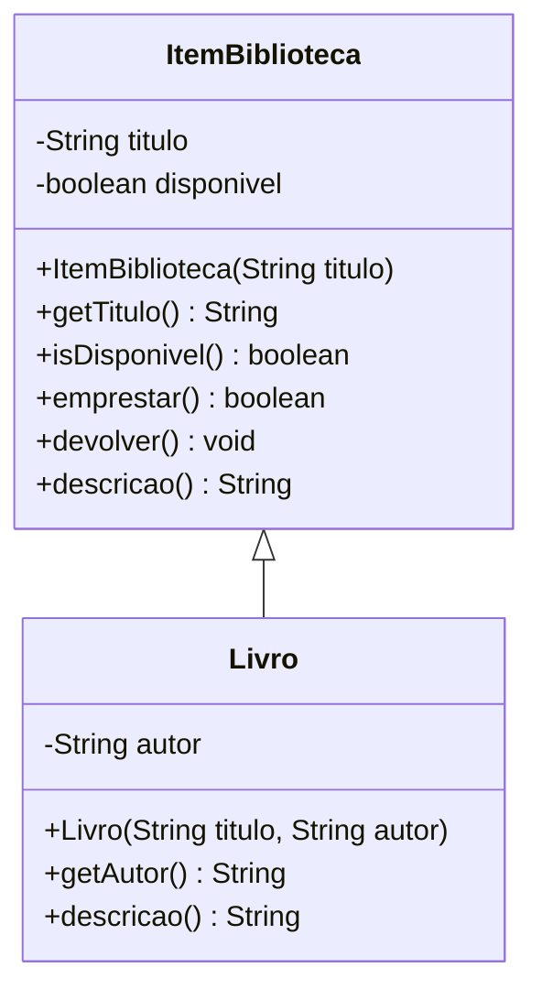

# Prática: da UML ao Java (biblioteca)

POO I • 3º INF • 27/10/2026 • aulas 3 e 4

Projeto do NetBeans pronto para abrir. A ficha impressa traz o diagrama e as regras.

## Como abrir

1. Copie esta pasta para o computador do laboratório.
2. No NetBeans: **File > Open Project** (em português: **Arquivo > Abrir Projeto**).
3. Selecione a pasta `2026-10-27_Aula01_Biblioteca`. O ícone de xícara confirma que o NetBeans reconheceu o projeto.
4. Abra esta pasta, e não a pasta do repositório inteiro. A prática é um projeto separado.
5. Em Source Packages, complete os `TODO` de `ItemBiblioteca.java` e `Livro.java`.
6. Não altere o `main` de `Aplicacao.java`.
7. Clique com o botão direito em `Aplicacao.java` e escolha **Run File** (Shift+F6). O botão de executar o projeto também usa essa classe.
8. Confira se a saída coincide com os comentários do `main`.

O projeto usa o pacote padrão e o código-fonte na versão 21. `Livro` herda de `ItemBiblioteca`. O construtor do livro já chama `super(titulo)`.

## Se o NetBeans não iniciar

No PowerShell, `java -version` pode mostrar o Java 17. Esse é o Java que o Windows encontra primeiro. O Apache NetBeans desta instalação só inicia com Java 21 ou mais novo. Se o `netbeans.exe` for chamado nesse Java 17, a janela não abre e aparece a mensagem pedindo Java 21.

O atalho do NetBeans já usa o JDK que vem com o programa, em `C:\Program Files\Apache NetBeans\jdk`. Para abrir pelo terminal nesta máquina:

```powershell
& "C:\Program Files\Apache NetBeans\bin\netbeans.exe" --jdkhome "C:\Program Files\Apache NetBeans\jdk"
```

Dentro do IDE, o projeto também precisa de uma plataforma JDK 21 ou mais nova, porque `nbproject/project.properties` fixa `javac.source=21` e `javac.target=21`. Com essa plataforma, **File > Open Project** na pasta desta atividade segue valendo.

O plano B do final deste arquivo chama o `javac` do terminal. Com o Java 17 esse comando ainda compila o exercício: o código não usa recurso exclusivo do Java 21.



## Regras que o código precisa cumprir

- Título e autor nulos ou em branco geram `IllegalArgumentException`.
- O item nasce disponível. `emprestar` retorna `false` se já estiver emprestado; senão, marca como indisponível e retorna `true`. `devolver` torna o item disponível de novo.
- `descricao` da superclasse devolve `Item: ` e o título. `Livro` sobrescreve e devolve `Livro: `, o título, ` | Autor: ` e o autor. Use `@Override`.

## Plano B, sem o NetBeans

No terminal, dentro desta pasta:

```powershell
New-Item -ItemType Directory -Force -Path build\classes | Out-Null
javac -encoding UTF-8 -d build\classes src\ItemBiblioteca.java src\Livro.java src\Aplicacao.java
java -cp build\classes Aplicacao
```

O molde compila antes dos `TODO`. A saída só fica correta depois que você implementar o comportamento.

Esta pasta não entra nos exemplos de `base_conhecimento`. Não misture estes arquivos com outra pasta de código da aula.
