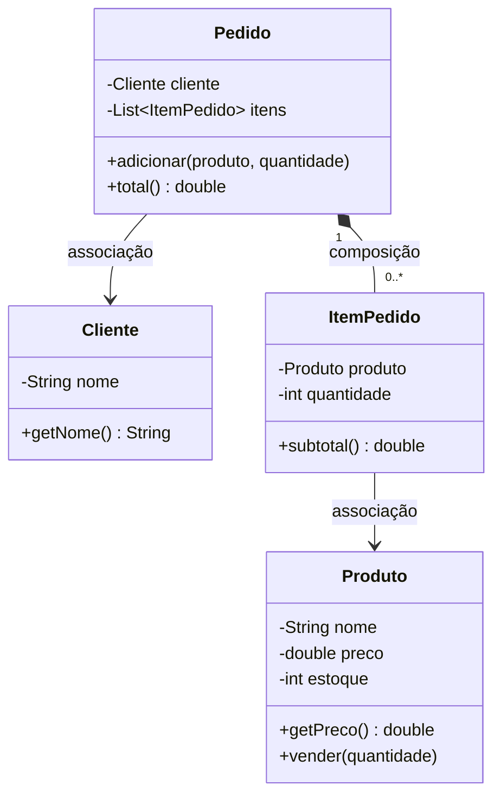

# Base de conhecimento (POO I)

Exemplos comentados para estudo, do Java básico à prévia de herança. Cada arquivo de uma pasta numerada roda sozinho, com o JDK 21. Não instala biblioteca.

A ordem segue a apostila da disciplina. Estes arquivos são a versão para abrir no Cursor e executar no terminal.

Herança e polimorfismo, além desta prévia, ficam para POO II.

## Como rodar

No terminal, a partir da raiz deste repositório:

```powershell
cd base_conhecimento\01_java_basico
java Ex01TiposVariaveis.java
```

Rode um arquivo por vez com `java Nome.java`.

Nas pastas `associacao` e `composicao`, cada classe pública está no próprio arquivo e o pacote é o nome da pasta. Compile a partir de `03_relacoes`:

```powershell
cd base_conhecimento\03_relacoes
javac composicao\*.java
java composicao.Ex03Composicao
```

A prévia de herança continua sem pacote:

```powershell
cd base_conhecimento\04_previa_heranca
javac *.java
java Ex01Heranca
```

## Ordem

| Pasta | O que pratica |
|---|---|
| `01_java_basico` | Tipos, decisões, laços, métodos, vetor e texto |
| `02_classes_e_objetos` | Classe, referência, encapsulamento, construtor, `static`, `toString` e `equals` |
| `03_relacoes` | `ArrayList`, associação, composição, exceção e teste no `main` |
| `04_previa_heranca` | `extends`, `super` e `@Override`. O restante é POO II |

## Cantina: classes que se relacionam

O domínio dos exemplos de relação é a cantina. Associação é "conhece". Composição é "é dono de e cria". A subpasta `associacao` mostra a seta do cliente. A subpasta `composicao` mostra os itens: lá o cliente fica só como nome, para o exemplo tratar de quem cria a lista.


